# 🌸 Bloom: Your First RTL Design

<p align="center">
  <strong>A beginner FPGA + RTL design lab</strong><br/>
  Specify a flower · Describe hardware · Simulate · Bloom on a real chip
</p>

| | |
|---|---|
| **Audience** | First-time hardware designers (workshop or intro digital lab) |
| **Hardware** | Digilent Basys 3 |
| **HDL** | SystemVerilog |
| **Time** | ~2 hours workshop · or one lab period + short report |
| **Working style** | Pairs recommended · one board per pair |

> [!TIP]
> Work **in order**. Checkpoints (`☐`) are stop signs: confirm before you continue. Write answers here or in a notebook. RTL goes in the starter source files—not in the margin.


| Section | What you will do | Est. time |
|---|---|---|
| Pre-lab | Vocabulary, truth table, no FPGA | 20–30 min before lab |
| Part 0 | Open Vivado, meet the Basys 3 | 10 min |
| Part I | Identify I/O | 5 min |
| Part II | Level 1 combinational flower | 25 min |
| Part III | Level 2 FSM flower | 40 min |
| Part IV | Optional visualizer | 15 min |
| Part V | Customize | remaining time |
| Reflection | Written wrap-up | 10 min |

If you get stuck, jump to [Debugging](#debugging-guide). Ask an instructor *after* you can say: “The spec says X; my sim shows Y.”

---

## Contents

1. [Lab overview](#lab-overview)
2. [Learning objectives](#learning-objectives)
3. [Prerequisites](#prerequisites)
4. [Pre-lab](#pre-lab)
5. [What is RTL?](#before-we-start-what-is-rtl)
6. [The RTL design flow](#the-rtl-design-flow)
7. [Materials](#materials)
8. [Part 0 — Setup](#part-0-lab-setup)
9. [Part I — Meet your FPGA](#part-i-meet-your-fpga)
10. [Part II — Level 1 bloom](#part-ii-level-1--make-the-flower-bloom)
11. [Part III — Level 2 grow](#part-iii-level-2--make-the-flower-grow)
12. [Part IV — Bring the flower to life](#part-iv-bring-your-flower-to-life)
13. [Part V — Customize](#part-v-customize-your-flower)
14. [Deliverables](#deliverables)
15. [Debugging](#debugging-guide)
16. [Vocabulary](#important-vocabulary)
17. [SystemVerilog quick reference](#systemverilog-quick-reference)
18. [Final reflection](#final-reflection)
19. [The big picture](#the-big-picture)
20. [Appendix A — Board map](#appendix-a-basys-3-control-map)
21. [Appendix B — Why we pulse grow](#appendix-b-why-level-2-does-not-skip-straight-to-bloom)
22. [Appendix C — Pair roles](#appendix-c-pair-roles-optional)

---

## Lab overview

Welcome to **Bloom**—your first introduction to RTL design and FPGA development.

You will design a tiny digital system that controls a virtual flower: start from a specification, turn it into logic, describe it in SystemVerilog, simulate it, then program a physical FPGA.

That is the same basic flow used in real digital hardware development:


You will have created hardware that you designed yourself.

> [!IMPORTANT]
> This is **not** a software coding exercise in disguise. The SystemVerilog you write describes **gates and registers**. If the circuit is wrong, the chip is wrong. Re-programming the same bitstream will not fix a bad description.

---

## Learning objectives

By completing this lab, you will be able to:

1. Read a simple hardware specification and identify its inputs and outputs.
2. Create a truth table from a behavioral description.
3. Translate Boolean logic into SystemVerilog.
4. Understand the difference between combinational and sequential logic.
5. Describe a simple finite state machine (FSM).
6. Write synthesizable SystemVerilog RTL.
7. Simulate and test an RTL design.
8. Synthesize RTL into FPGA hardware.
9. Program an FPGA using Vivado.
10. Connect physical hardware to a visual software representation.
11. Debug a mismatch among specification, simulation, and the board.

---

## Prerequisites

You do **not** need prior FPGA experience. Helpful (but not required):

- Boolean algebra (`AND`, `OR`, `NOT`)
- Comfort saving files and following numbered software steps
- Optional: any prior programming language

Complete the **pre-lab** before you sit down at a board if this is a graded course lab.

### Lab norms

- Treat boards and USB cables as shared equipment.
- The Basys 3 uses a **micro-USB** programming cable—do not force connectors.
- Food and drinks stay away from the boards.
- You belong in this lab. “What should happen on this input?” is the professional question.
- If the board smells like burning or gets hot, **unplug** and get an instructor.

---

## Pre-lab

Do this on paper or in a text file. **No Vivado required.**

### P1. Software vs hardware

In one or two sentences, explain the difference between writing a program that *runs on* a processor, and writing RTL that *becomes* a circuit.

____________________________________________________

### P2. Identify I/O

A lamp should turn on only if the wall switch is on **and** the lamp is plugged in.

- Inputs: ____________________________________________________
- Output: ____________________________________________________
- Boolean equation: ____________________________________________________

### P3. Truth table

Fill in Bloom’s Level 1 table: *the flower blooms only when it has both water and sunlight.*

| Water | Sun | Bloom |
|:---:|:---:|:---:|
| 0 | 0 |  |
| 0 | 1 |  |
| 1 | 0 |  |
| 1 | 1 |  |

### P4. State (preview)

If a flower must remember whether it is a seed, a sprout, or in bloom, is that **combinational** or **sequential** logic? Why?

____________________________________________________

Bring this page to lab.

---

## Before we start: What is RTL?

**RTL** means **Register-Transfer Level**—a way engineers describe how digital hardware should behave.

| When writing software you ask | When designing hardware you ask |
|---|---|
| “What instructions should the computer execute?” | “What logic, registers, and connections should exist so the circuit behaves this way?” |

Suppose a flower blooms only when it has both water and sunlight:

**Bloom = Water AND Sunlight**

```systemverilog
assign bloom = water & sun;
```

That line does **not** tell a processor what to do. It describes hardware: an AND gate whose output is the `bloom` net.

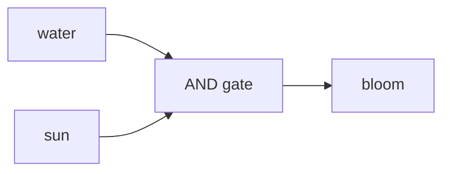

### HDL vs “code”

| | Software | RTL (this lab) |
|---|---|---|
| Language might look similar | Python, C | SystemVerilog |
| What you are creating | Instructions for a CPU | Gates, wires, flip-flops |
| Time | Statements run one after another | Many statements describe **parallel** hardware |
| `always_ff @(posedge clk)` | “A loop” | “This register updates on the clock edge” |

If you write RTL as if it were Python, you will get surprising hardware. Prefer small, synthesizable constructs: `assign`, `always_comb`, `always_ff`, `case`.

---

## The RTL design flow

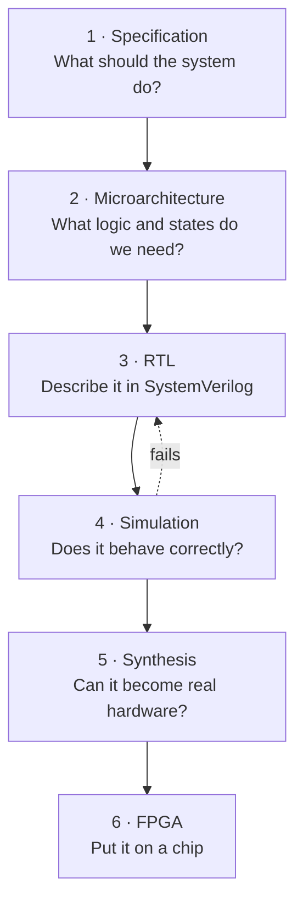

> [!WARNING]
> Simulation is not optional. Programming a wrong bitstream teaches the wrong lesson (“the hardware is flaky”) when the bug was in the RTL.

---

## Materials

Each group needs:

| Required | Optional |
|---|---|
| Basys 3 FPGA board | Flower overlay for the LEDs |
| Micro-USB cable | Python 3 + `pyserial` for the visualizer |
| Computer with Vivado | |
| Starter files (`rtl/`, `constraints/`) | |
| This lab manual | |

**Target board:** Digilent **Basys 3** (`xc7a35tcpg236-1`). A different board needs a different `.xdc` from your instructor.

### What the starter project already did for you

You do **not** need to create the Vivado project from scratch, choose the FPGA part, write pin constraints, or write the debounce wrapper.

You **do** need to fill in the flower modules and prove them in simulation.

---

## Part 0: Lab setup

Follow [`vivado-cheatsheet.md`](vivado-cheatsheet.md) for click-level detail.

1. Launch **Vivado**.
2. Open the provided Bloom project, **or** create a Basys 3 project and add the `rtl/` files plus `constraints/basys3_bloom.xdc`.
3. Confirm `flower_level1.sv` appears under **Sources**.
4. Point to these parts on the **physical board** ([Appendix A](#appendix-a-basys-3-control-map)):

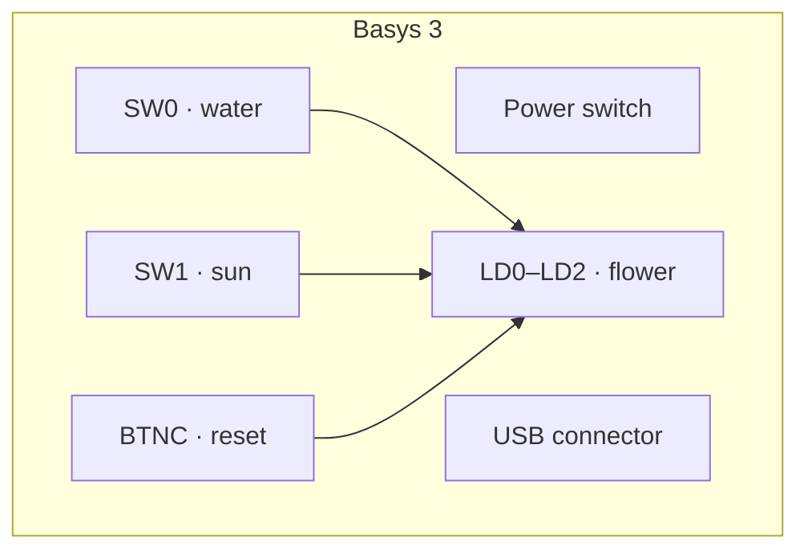

☐ Vivado project opens  
☐ I can point to SW0, SW1, BTNC, and LD0 on the board

---

## Part I: Meet your FPGA

An **FPGA** is a **Field-Programmable Gate Array**.

Unlike a processor, where you write software that runs on a fixed architecture, an FPGA can be configured to implement **your** digital hardware. Think of it as a blank digital canvas: you give it a design, and it configures itself to behave like that design.

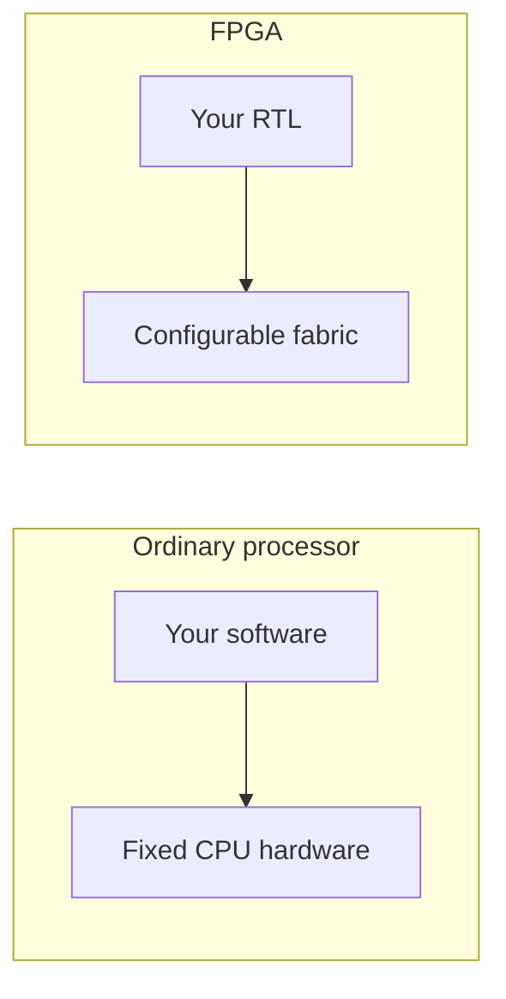

### Inputs and outputs

| Direction | Signals | Where they come from |
|---|---|---|
| Inputs | `water`, `sun`, `reset` (Level 2), `clk` (Level 2) | Switches, buttons, 100 MHz oscillator (after a debounce wrapper) |
| Outputs | Flower LEDs, `state_code` | So you can *see* the hardware |

### Lab Checkpoint 1

Before writing RTL:

**What are the inputs to our system?**

____________________________________________________

**What are the outputs?**

____________________________________________________

**What should happen when both water and sunlight are present? (Level 1)**

____________________________________________________

---

## Part II: Level 1 — Make the flower bloom

### The specification

> **The flower blooms only when it has both water and sunlight.**

If either is missing, it does not bloom.

Level 1 is **purely combinational**. There is no memory. Turn a switch off, and `bloom` goes off immediately.

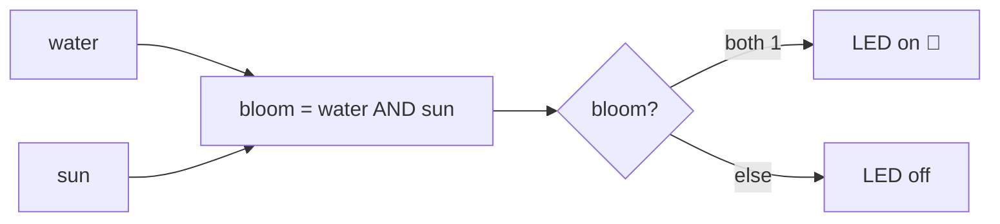

### Step 1: Identify the inputs and output

**Inputs:** `water`, `sun` · **Output:** `bloom`

### Step 2: Build the truth table

A truth table lists every input combination.

| Water | Sun | Bloom |
|:---:|:---:|:---:|
| 0 | 0 | 0 |
| 0 | 1 | 0 |
| 1 | 0 | 0 |
| 1 | 1 | 1 |

#### Think about it

Why doesn't the flower bloom when **Water = 1, Sun = 0**?

____________________________________________________

Why doesn't the flower bloom when **Water = 0, Sun = 1**?

____________________________________________________

### Step 3: Translate the specification into logic

The output is `1` only when `water = 1` **and** `sun = 1`:

```text
bloom = water AND sun
```

That is an **AND gate**. In SystemVerilog, bitwise AND is `&`.

### Step 4: Describe the hardware in SystemVerilog

Open `flower_level1.sv`. You should see:

```systemverilog
module flower_level1 (
    input  logic water,
    input  logic sun,
    output logic bloom
);

    // TODO: bloom should be water AND sun

endmodule
```

#### Design task (Level 1)

Write the SystemVerilog that makes `bloom` equal to `water AND sun`.

Allowed: a continuous `assign`, or an `always_comb` block.

> [!CAUTION]
> Do **not** use `always_ff` or a clock in Level 1.

**Your line (lab notebook):**

```systemverilog

```

### Step 5: Simulate your design

**Simulation** tests the design without the FPGA. `tb_flower_level1.sv` applies all four combinations:

| Water | Sun | Expected Bloom |
|:---:|:---:|:---:|
| 0 | 0 | 0 |
| 0 | 1 | 0 |
| 1 | 0 | 0 |
| 1 | 1 | 1 |

**How:** [Vivado cheat sheet — simulation](vivado-cheatsheet.md#run-behavioral-simulation)

The console should print `PASS` for each vector and `LEVEL1 TESTBENCH PASSED`. `FAIL` means your `assign` does not match the table.

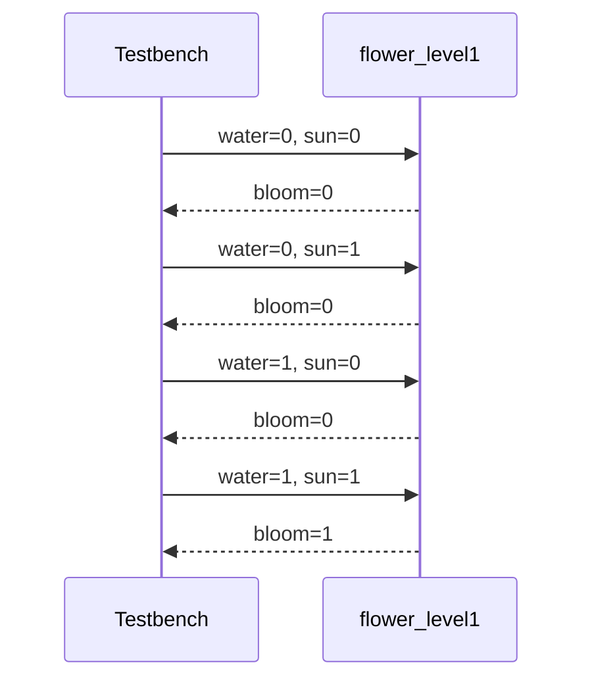

#### Checkpoint

Does your simulation match the truth table?

☐ Yes  ☐ No

If not, **stop and debug** before continuing.

### Step 6: Turn your RTL into hardware

Set **`top_level1`** as the synthesis/implementation top.


The project is already constrained. You do **not** assign pins or choose the device. You build the design.

### Step 7: Program the FPGA

Connect USB, turn the board **on**, then in Vivado:

1. Generate the bitstream.
2. Open **Hardware Manager**.
3. Connect to the FPGA.
4. Program the device.

The Basys 3 **DONE** LED should light. Your design is physically running.

### Step 8: Test your flower

| Control | Meaning |
|---|---|
| SW0 | `water` |
| SW1 | `sun` |
| LD0 | `bloom` (on = bloom) |

| Water | Sun | What should happen? |
|:---:|:---:|---|
| 0 | 0 | Flower does not bloom (LD0 off) |
| 0 | 1 | Flower does not bloom |
| 1 | 0 | Flower does not bloom |
| 1 | 1 | Flower blooms (LD0 on) |

#### Checkpoint

If your FPGA disagrees with simulation, what could be wrong?

____________________________________________________

☐ Level 1 demo complete (instructor stamp / initials: ______)

---

## Part III: Level 2 — Make the flower grow

A real flower does not jump from seed to bloom. Ours will have three stages, and it **remembers** which stage it is in.


### State

**State** is information a digital system remembers: *“Am I a seed, a sprout, or a bloom?”*

### The new specification

| Event | What happens |
|---|---|
| Power-up / **reset** | **SEED** |
| One **grow** event (water AND sun) | SEED → **SPROUT** |
| Another **grow** event | SPROUT → **BLOOM** |
| Further grow events | Stay **BLOOM** |

#### What is a “grow event”?

The Basys 3 clock is **100 MHz**. If the FSM advanced whenever `water & sun` stayed high, holding both switches for a millisecond would skip **SEED → SPROUT → BLOOM** before you could watch.

The lab wrapper therefore feeds your FSM a **one-cycle pulse** named `grow` when water and sun are both ON (typically when you flip the second switch on, or tap **BTNU**—see Appendix A).

> [!IMPORTANT]
> Advance on `grow`, not on the raw levels of `water` and `sun`. On paper you may still label arcs *water AND sun*—they mean the same event.

See [Appendix B](#appendix-b-why-level-2-does-not-skip-straight-to-bloom) for the hardware reason.

### Step 1: Draw the state diagram

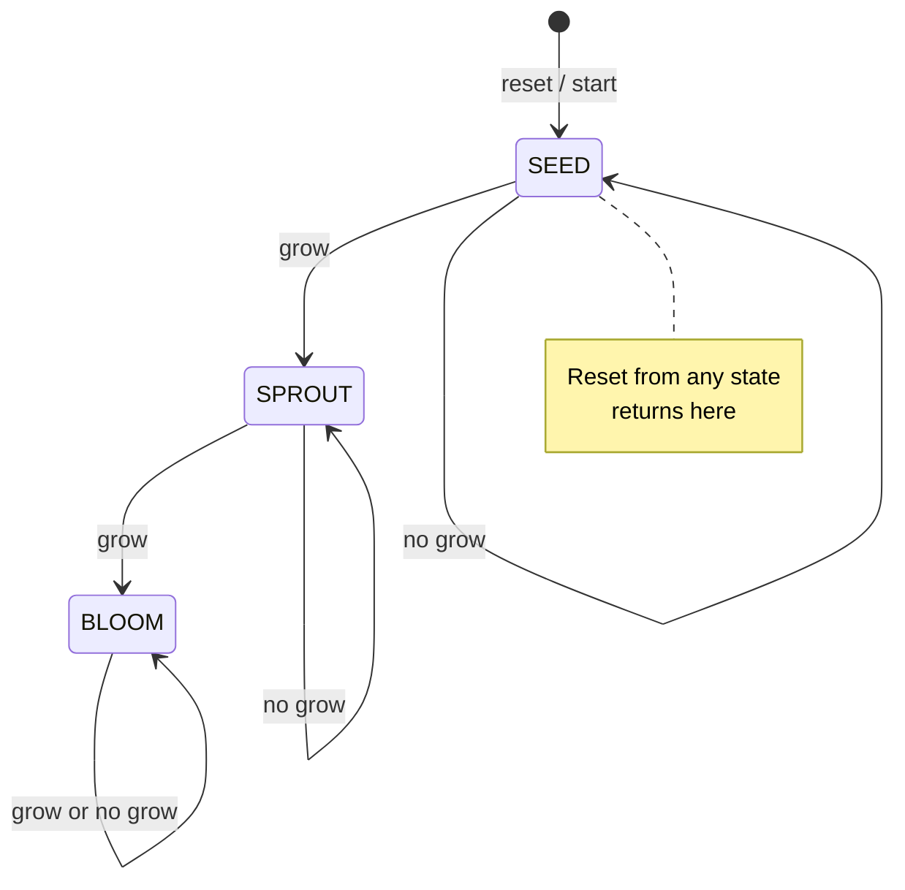

**Draw your own copy** (boxes + arrows). Label the reset arc.

____________________________________________________

### Step 2: State transition table

| Current State | grow | Next State |
|---|:---:|---|
| SEED | 0 | SEED |
| SEED | 1 | SPROUT |
| SPROUT | 0 | SPROUT |
| SPROUT | 1 | BLOOM |
| BLOOM | 0 | BLOOM |
| BLOOM | 1 | BLOOM |

`grow = 1` means this clock cycle is a water+sun event. BLOOM never leaves except via **reset**, which forces `state <= SEED` in the register block.

### Step 3: Think like a hardware designer

Level 1 used **combinational** logic. Level 2 needs **sequential** logic—memory.

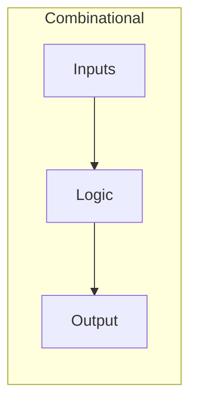

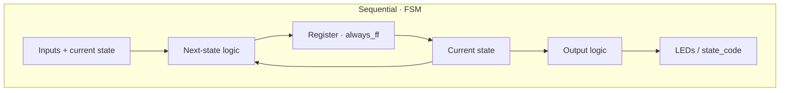

A clean FSM has three pieces:

1. **State register** — `always_ff`, holds `state`
2. **Next-state logic** — `always_comb`, computes `next_state`
3. **Output logic** — `always_comb` or `assign`, drives LEDs / `state_code`

### Step 4: Define the states

```systemverilog
typedef enum logic [1:0] {
    SEED,
    SPROUT,
    BLOOM
} state_t;

state_t state;       // where am I now?
state_t next_state;  // where should I go next?
```

### Step 5: Design the next-state logic

| If I am in… | grow = 0 | grow = 1 |
|---|---|---|
| **SEED** | ? | ? |
| **SPROUT** | ? | When do I become BLOOM? |
| **BLOOM** | ? | Do I ever leave (except reset)? |

**Fill in:**

| Current | grow | Next |
|---|---|---|
| SEED | 0 |  |
| SEED | 1 |  |
| SPROUT | 0 |  |
| SPROUT | 1 |  |
| BLOOM | X |  |

### Design task (Level 2)

Complete the FSM in `flower_level2.sv`. Include:

1. A state register
2. Next-state logic
3. Reset behavior
4. Outputs for the current state

| State | `state_code` | LED |
|---|---|---|
| SEED | `2'd0` | LD0 |
| SPROUT | `2'd1` | LD1 |
| BLOOM | `2'd2` | LD2 |

### A typical FSM structure

```systemverilog
// State register
always_ff @(posedge clk or posedge reset) begin
    if (reset)
        state <= SEED;
    else
        state <= next_state;
end
```

```systemverilog
always_comb begin
    next_state = state; // default: hold

    case (state)
        SEED: begin
            // remain SEED or move to SPROUT
        end
        SPROUT: begin
            // remain SPROUT or move to BLOOM
        end
        BLOOM: begin
            // stay BLOOM
        end
        default: begin
            next_state = SEED;
        end
    endcase
end
```

**Hints:** keep the default `next_state = state`; always include `default`; watch `;` and `end`.

### Step 6: Simulate the FSM

Use `tb_flower_level2.sv`. A passing run looks like:


| Test | Stimulus | Expected |
|---|---|---|
| 1 | Reset, grow, grow | SEED → SPROUT → BLOOM |
| 2 | Reset, no grow | Stay SEED |
| 3 | Reset, grow, then `grow = 0` | SEED → SPROUT and **hold** |
| 4 | Reset, grow, grow, grow | SEED → SPROUT → BLOOM → BLOOM |

The testbench prints `LEVEL2 TESTBENCH PASSED` when these sequences match.

#### Checkpoint

☐ Reset returns the flower to SEED  
☐ No grow pulse does not advance the flower  
☐ One grow pulse: SEED → SPROUT  
☐ Second grow pulse: SPROUT → BLOOM  
☐ BLOOM stays BLOOM  
☐ `state_code` is 0, 1, 2 in those states

### Step 7: Program the FPGA

Set **`top_level2`** as the implementation top, then: save → synthesis → implementation → bitstream → Hardware Manager → program.

### Step 8: Grow your flower

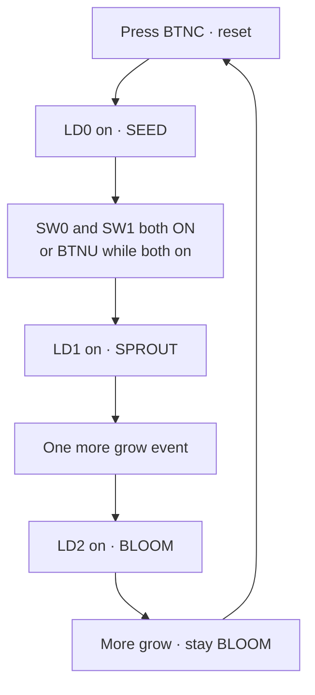

Congratulations—you designed and programmed a finite state machine.

☐ Level 2 demo complete (initials: ______)

---

## Part IV: Bring your flower to life

The FPGA owns the flower state. A computer app can **visualize** it—but the FPGA is the source of truth.

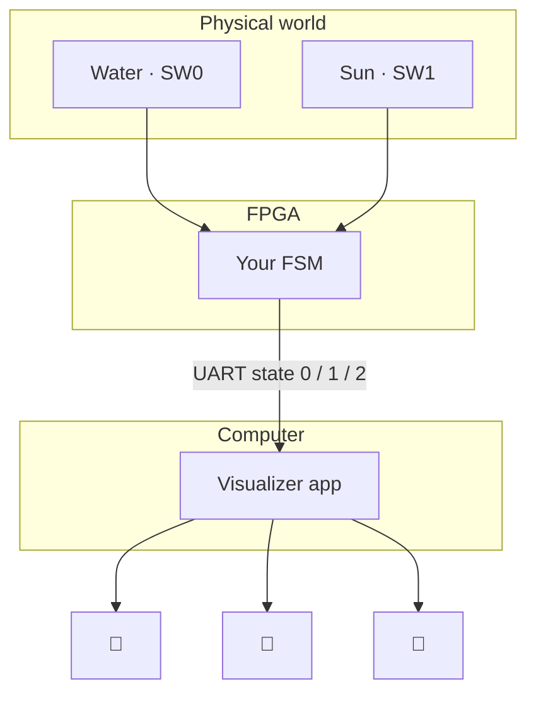

> **The FPGA is the source of truth.** The app only displays what the hardware is doing.

### FPGA-to-app communication

Level 2’s wrapper sends a UART byte periodically:

| Byte | State | App |
|---|---|---|
| ASCII `'0'` | SEED | 🌱 |
| ASCII `'1'` | SPROUT | 🌿 |
| ASCII `'2'` | BLOOM | 🌸 |

Baud: **115200**, 8N1.

```text
python viz/bloom_viz.py COM5
```

Replace `COM5` with your port (Windows Device Manager → Ports). Install with `pip install pyserial`. Skip this part if your site has no visualizer—LEDs are enough.

### What you are learning

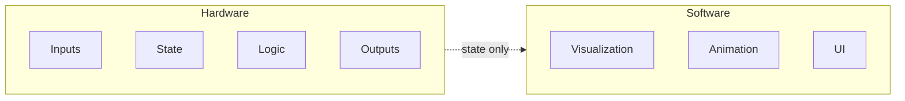

Neither side should do the other’s job. That split shows up in SoCs, consoles, cars, and medical devices.

---

## Part V: Customize your flower

Make it yours. **Update the spec and diagram before writing RTL.**

### Challenge 1: Change the flower

Different colors, species in `bloom_viz.py`, animation, background, clouds or rain.

### Challenge 2: Add a new state

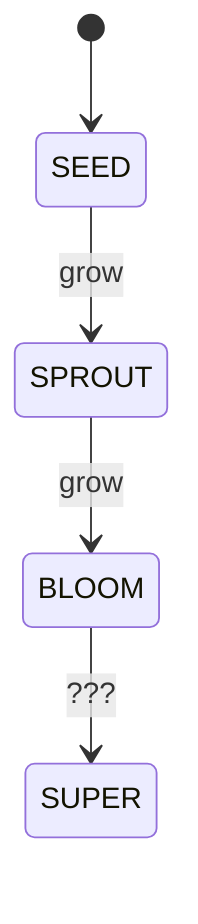

You must define: the new state, the transition, the outputs, and a diagram.

`state_t` is `[1:0]` today (four codes)—SUPER BLOOM still fits. A fifth state needs a wider enum.

### Challenge 3: Add a bad-weather state

Add **WILTED**. Design transitions *into* and *out of* it on paper first.

### Challenge 4: Design your own system

Start with specification, inputs, outputs, states, then RTL.

Ideas: 3-cycle password lock · traffic light · red light / green light.

---

## Deliverables

Course version (workshops may only stamp checkpoints):

1. Completed pre-lab
2. Checkpoints and reflection (this manual or typed equivalent)
3. `flower_level1.sv` and `flower_level2.sv`
4. Simulation transcript or passing-testbench screenshot
5. Pair names + what you demonstrated on the board
6. Optional: challenge RTL + new state diagram

See [`grading-rubric.md`](grading-rubric.md).

---

## Debugging guide

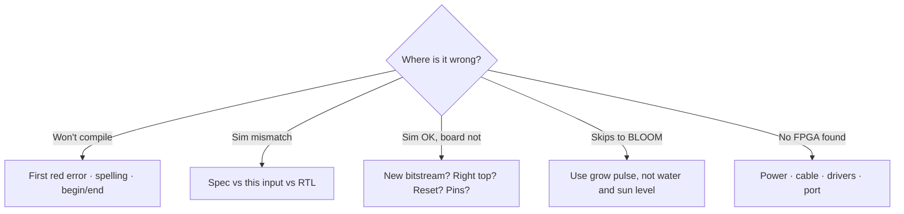

### "My code won't compile."

Spelling, semicolons, module/port names, missing `end`, matching `begin`/`end`, `logic` types, one driver per signal.

### "My simulation is wrong."

Ask: *What should happen for this exact input?* Walk **specification → expected → RTL → sim**. Find the *first* wrong moment—don’t rewrite everything.

Level 2: default `next_state = state`? Using `grow`? Did reset go high?

### "My simulation works, but the FPGA doesn't."

1. New bitstream after the last save?
2. SW0 / SW1 / BTNC as in Appendix A?
3. Did you reset (Level 2)?
4. Correct top (`top_level1` vs `top_level2`)?
5. One grow pulse at a time?

### "The flower jumps straight to BLOOM."

Raw `water & sun` as a **level**, not a pulse. Use `grow`. See Appendix B.

### "Vivado is giving me an error."

Read the **first** red error, not the last line.

### "Hardware Manager cannot find the device."

Power on, programming USB port, cable drivers, try another cable/port.

---

## Important vocabulary

| Term | Meaning |
|---|---|
| **FPGA** | Programmable device that implements custom digital hardware |
| **RTL** | Register-Transfer Level description of hardware |
| **SystemVerilog** | HDL used to describe digital circuits |
| **Combinational logic** | Output depends only on current inputs (AND, OR, NOT, muxes) |
| **Sequential logic** | Involves memory (registers, counters, FSMs) |
| **Register** | Flip-flops that remember values, updated on a clock |
| **FSM** | Finite state machine: finite states, transitions on inputs |
| **Synthesis** | RTL → hardware implementation |
| **Bitstream** | File that programs the FPGA |
| **Simulation** | Test behavior before the chip |
| **Testbench** | HDL that stimulates (and often checks) your module—usually **not** synthesized |
| **Constraints (XDC)** | Maps RTL ports to physical pins |
| **Debounce** | Filters switch bounce so the FSM doesn’t see dozens of false grows |

---

## SystemVerilog quick reference

### Module

```systemverilog
module example (
    input  logic a,
    input  logic b,
    output logic y
);
endmodule
```

### AND / OR / NOT

```systemverilog
assign y = a & b;
assign y = a | b;
assign y = ~a;
```

### Conditional

```systemverilog
assign y = a ? b : c;
```

### Combinational / sequential

```systemverilog
always_comb begin
    // logic  — use =
end

always_ff @(posedge clk) begin
    // registers  — use <=
end
```

### Case

```systemverilog
case (state)
    SEED:   begin /* ... */ end
    SPROUT: begin /* ... */ end
    BLOOM:  begin /* ... */ end
endcase
```

> [!TIP]
> `always_comb` → `=` · `always_ff` → `<=`. Mixing these randomly is a common sim-vs-FPGA mismatch.

---

## Final reflection

### 1. What is the difference between combinational and sequential logic?

____________________________________________________

### 2. Why does our Level 2 flower need a register?

____________________________________________________

### 3. What is the purpose of a state diagram?

____________________________________________________

### 4. Why did we simulate before programming the FPGA?

____________________________________________________

### 5. What was the hardest part of designing the flower?

____________________________________________________

### 6. What would you design if you had another hour?

____________________________________________________

### 7. Name one thing your **partner** explained well (if you worked in a pair).

____________________________________________________

---

## The big picture

You started with: *“I want a flower that blooms when it gets water and sunlight.”*

You turned that into a specification, a truth table, Boolean logic, SystemVerilog, a simulation, an FSM, FPGA hardware, and a digital flower.

**You don't start with code.** You start with *what should the hardware do?* Then *what hardware do I need?* Only then do you write RTL.

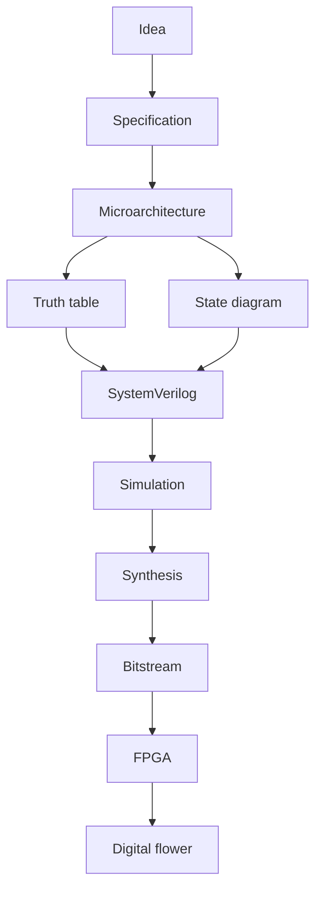

### You just designed hardware.

---

## Appendix A: Basys 3 control map

These names match `constraints/basys3_bloom.xdc` and the `top_level*` wrappers.

```mermaid
flowchart LR
  subgraph inputs["Inputs"]
    CLK[100 MHz · W5]
    SW0[SW0 · water]
    SW1[SW1 · sun]
    C[BTNC · reset]
    U[BTNU · extra grow]
  end
  subgraph fpga["FPGA fabric"]
    TOP[top_level2 wrapper]
    F[Your flower_level2]
  end
  subgraph outputs["Outputs"]
    LD0[LD0 · SEED / L1 bloom]
    LD1[LD1 · SPROUT]
    LD2[LD2 · BLOOM]
    UART[A18 · UART TX]
  end
  CLK --> TOP
  SW0 --> TOP
  SW1 --> TOP
  C --> TOP
  U --> TOP
  TOP --> F
  F --> LD0
  F --> LD1
  F --> LD2
  TOP --> UART
```

| Board part | RTL (after wrapper) | Role |
|---|---|---|
| 100 MHz clock (W5) | `clk` | FSM clock |
| SW0 | `water` | Water |
| SW1 | `sun` | Sun |
| BTNC | `reset` | Return to SEED (hold ~0.2 s) |
| BTNU | `grow_btn` | Optional extra grow |
| LD0 | seed / bloom L1 | Level 1: bloom · Level 2: SEED |
| LD1 | sprout | Level 2: SPROUT |
| LD2 | bloom | Level 2: BLOOM |
| USB-UART TX (A18) | `uart_tx` | Visualizer (Level 2) |

**Grow in `top_level2`:** one-clock pulse when **SW0 and SW1 just became both 1**, or **BTNU pressed while both are 1**. Release and apply again to go SPROUT → BLOOM.

---

## Appendix B: Why Level 2 does not skip straight to BLOOM

Flip-flops sample on every rising clock. At 100 MHz that is every **10 ns**.

```mermaid
sequenceDiagram
  participant SW as Switches held ON
  participant CLK as 100 MHz clock
  participant FSM as Level-sensitive FSM
  SW->>FSM: water and sun = 1
  CLK->>FSM: edge 1
  FSM->>FSM: SEED → SPROUT
  CLK->>FSM: edge 2
  FSM->>FSM: SPROUT → BLOOM
  Note over FSM: Millions of edges while you hold the switches
```

If next-state logic is “if water and sun, advance,” one long assertion lasts millions of clocks.

Engineers use a **one-cycle pulse**, **edge detection** on `(water & sun)`, or a slow tick. This lab uses edge detection in the **wrapper** so your FSM stays a textbook 3-state machine.

---

## Appendix C: Pair roles (optional)

Swap every 15 minutes:

| Role | Job |
|---|---|
| **Driver** | Types RTL |
| **Navigator** | Watches the spec, truth table, and Vivado messages |

Both must be able to explain the AND gate and the FSM at the end.
